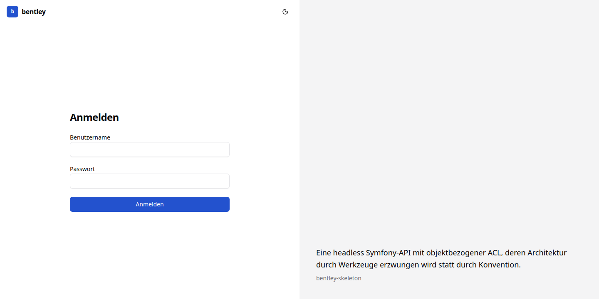
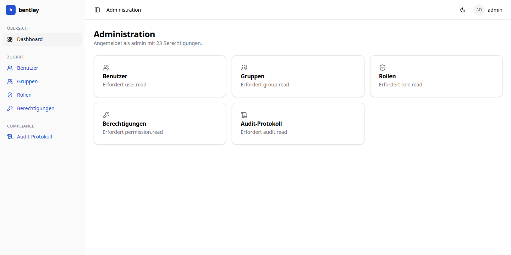
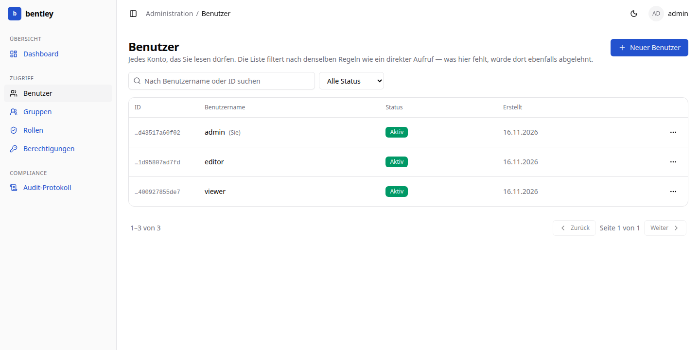
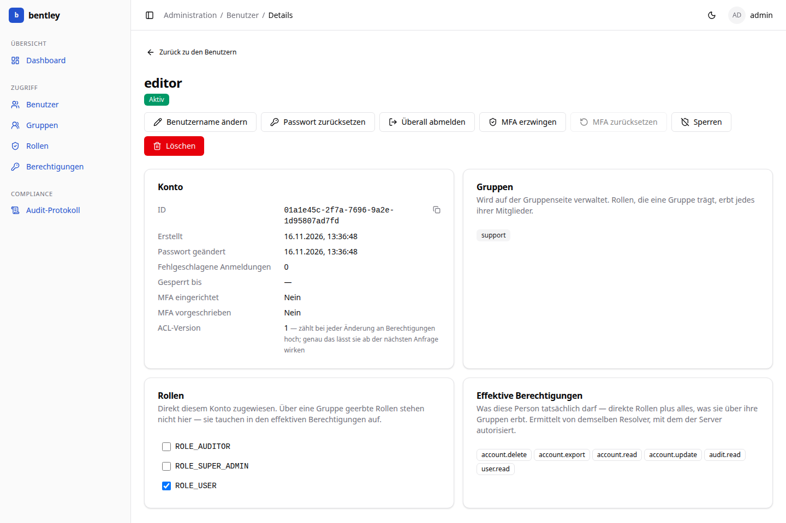
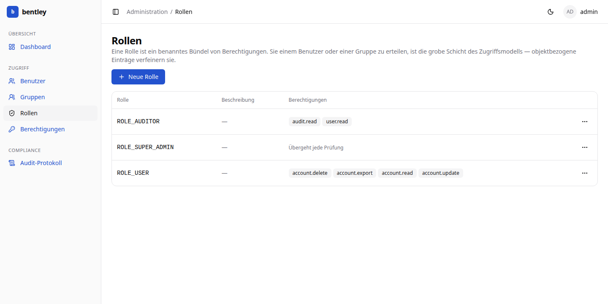
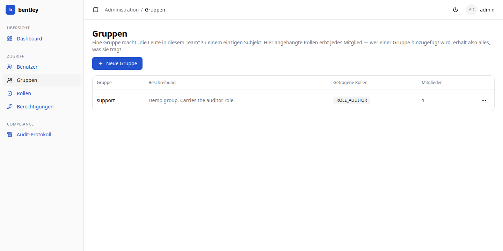
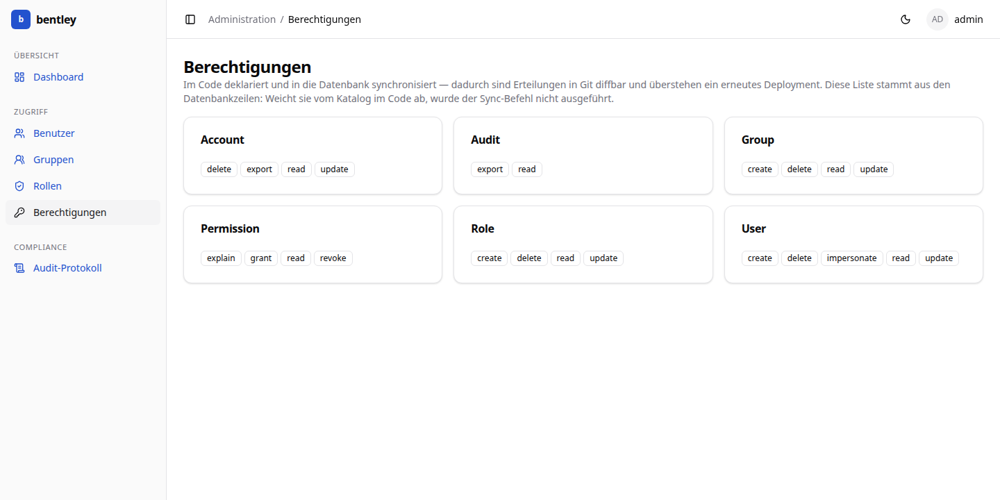
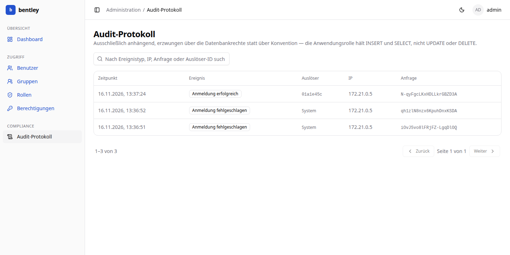
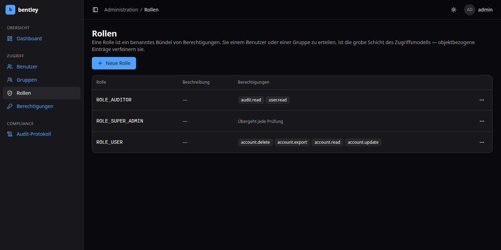

<div align="center">

# bentley-skeleton

**A security-hardened template for headless Symfony 7.4 + Vue 3 applications** — JWT authentication
with rotating refresh tokens, a per-object ACL, and an architecture enforced by tooling rather than
convention.

[](https://github.com/blackburn2601/bentley-skeleton/actions/workflows/ci-backend.yml)
[](https://github.com/blackburn2601/bentley-skeleton/actions/workflows/ci-frontend.yml)
[](https://github.com/blackburn2601/bentley-skeleton/actions/workflows/architecture.yml)
[](https://github.com/blackburn2601/bentley-skeleton/actions/workflows/codeql.yml)


</div>

---

## About

Most starter kits give you a login form and a folder structure, then leave the rules to
convention. This one ships the rules as **failing builds**: layer boundaries, controller shape,
service size and authorization coverage are checked on every push, and a violation names the
invariant it broke and how to fix it.

It is built to be extended by people **and by AI sessions with no prior context**. That goal
shapes everything else: decisions are written down with their rejected alternatives (31 ADRs),
and the inventories that answer "does this already exist?" — endpoints, permissions, services —
are generated from the code and checked for freshness in CI.

> **Working in this repo?** Read [`CLAUDE.md`](CLAUDE.md) first — it is the entry point for
> humans and agents alike, and it is short.

## Screenshots

The template ships with a small admin SPA (German UI) so the security model is visible, not just
described. Demo data comes from `make fixtures`.

|  |  |
|:--:|:--:|
|  |  |
| **Sign-in** — admin-issued username credentials | **Administration** — one entry per area, each naming the permission it needs |
|  |  |
| **Users** — list filtered by the same rules as a direct request | **User detail** — direct roles, inherited group roles, *effective permissions* |
|  |  |
| **Roles** — named bundles of permissions | **Groups** — one subject for "everyone on this team" |
|  |  |
| **Permissions** — catalogue declared in code, synced to the database | **Audit log** — append-only, enforced by database grants, searchable |

<div align="center">

<br><em>Dark theme follows the system preference</em>
</div>

---
## Quick start

```bash
make hooks                    # install the git hooks
make up                       # start the stack
make migrate fixtures         # schema + demo dataset
```

| | |
|---|---|
| API | <http://localhost:8080> |
| SPA | <http://localhost:5173> |
| OpenAPI spec | <http://localhost:8080/api/doc.json> |

Sign in at <http://localhost:5173> as `admin`, `editor` or `viewer` with the demo password
`demo-password-not-for-real-use` (demo fixtures only).
Then `make check` runs everything CI runs.

## Starting a real project from this template

```bash
make new-project NAME=acme-api
```

Rewrites every package, compose and image name, generates a fresh per-machine
`backend/.env` (`APP_SECRET`, JWT passphrase, TOTP key — via `bin/generate-env`; the file is
gitignored and never committed, see ADR-0028), regenerates the JWT keypair, and prints the
five things you must decide before shipping. It does **not** decide them for you — none of
them have a safe default.

---

## What is in the box

**Authentication** — argon2id, RS256 access tokens (10 min), opaque refresh tokens rotated
on every use with reuse detection that revokes the whole family, admin-issued username
credentials with one-time temporary passwords, per-account lockout with exponential
backoff, HIBP k-anonymity password checks, session and device management. Everything in
`__Host-` cookies.

**Authorization** — a real per-object ACL: users, groups, roles, permissions and
object-scoped entries, resolved most-specific-first with deny beating allow. Collection
endpoints are filtered in SQL by the same rules, and an integration test asserts the list and
the single-item check can never disagree. `explain()` answers "why can't this user do this?"
in production.

**Hardening** — RFC 9457 `problem+json` errors, security headers with a nonce-based CSP, a
CORS allowlist, an SSRF-guarded HTTP client, payload limits, and seven named rate-limit
policies backed by Redis.

**Compliance** — an append-only security event log with INSERT-only database grants, entity
change history, GDPR export and erasure.

**Operations** — one FrankenPHP image for development and production, read-only rootfs,
dropped capabilities, Docker secrets, gated migrations, JSON logs, request-id correlation,
Sentry, optional OpenTelemetry, liveness and readiness probes, Prometheus metrics.

---

## Why the pipeline is strict

The architecture is enforced by tooling, not convention: deptrac for layer and context
direction, custom PHPStan rules for the shape of controllers and services, PHPMD for size and
complexity. Break a rule and the build fails with a message naming the invariant and the fix.

`make proof` demonstrates this both ways — it plants a deliberate violation of each rule and
asserts every one fires, then generates a fully conforming slice and asserts it produces no
errors at all. A rule that cannot be satisfied is a bug in the rule.

`make endpoint` generates a complete conforming slice, so the correct path is also the
fastest one.

---

## Tech stack

| | |
|---|---|
| Backend | PHP 8.5 · Symfony 7.4 · Doctrine ORM · FrankenPHP |
| Auth | `lexik/jwt-authentication-bundle` (RS256) · argon2id · opaque rotating refresh tokens · TOTP |
| Data | PostgreSQL 18 · Redis (rate limits) |
| Frontend | Vue 3.5 · Vite 8 · Pinia · Tailwind CSS 4 · reka-ui · TypeScript |
| API contract | RFC 9457 `problem+json` · OpenAPI via `nelmio/api-doc-bundle` |
| Quality gates | PHPStan (`level: max`) · deptrac · PHPMD · Rector · PHPUnit 13 · Vitest · Playwright |
| Security CI | CodeQL · Semgrep · secret scan · `composer`/`npm audit` · Trivy image scan |
| Ops | Docker Compose (dev + prod) · read-only rootfs · Docker secrets · Prometheus metrics · Sentry / OpenTelemetry |

## Architecture at a glance

```
backend/src/
├── Account/    authentication, provisioning, sessions, token rotation
├── Acl/        permission model, PermissionResolver, AclCriteriaBuilder
├── Audit/      append-only security events, entity history, GDPR export/erasure
├── Platform/   health checks, observability, rate limiting, request ids
├── Shared/     domain primitives (Clock, IdGenerator, value objects)
├── Api/        ALL HTTP: controllers, request DTOs, views, voters
└── Maker/      dev-time generators (`make endpoint`, `make service`, `make adr`)
```

Each context has `Domain/`, `Application/` and `Infrastructure/`; contexts talk to each other
only through a `<Context>Facade`. Keeping all HTTP in `Api/` means authorization coverage can be
reviewed in one pass. See [`docs/ARCHITECTURE.md`](docs/ARCHITECTURE.md) for the context map and
the ACL decision flow.

---

## Documentation

| | |
|---|---|
| [`CLAUDE.md`](CLAUDE.md) | Entry point. Start here. (`AGENTS.md` is identical.) |
| [`docs/INVARIANTS.md`](docs/INVARIANTS.md) | The rules, why each exists, and what enforces it |
| [`docs/ARCHITECTURE.md`](docs/ARCHITECTURE.md) | Context map, request lifecycle, ACL decision flow |
| [`docs/adr/`](docs/adr/) | Every significant decision, with rejected alternatives |
| [`docs/cookbook/`](docs/cookbook/) | Copy-pasteable recipes for common changes |
| [`docs/SECURITY.md`](docs/SECURITY.md) | Threat model and OWASP mapping, each control with its test |
| [`docs/OPERATIONS.md`](docs/OPERATIONS.md) | Deploy, roll back, restore, observe |

---

## Requirements

Docker is all you need to run it. To work on the code outside containers: PHP 8.5,
Composer 2, Node 26.

## License

No license has been chosen yet, so all rights are reserved. Add one before reusing this code.
